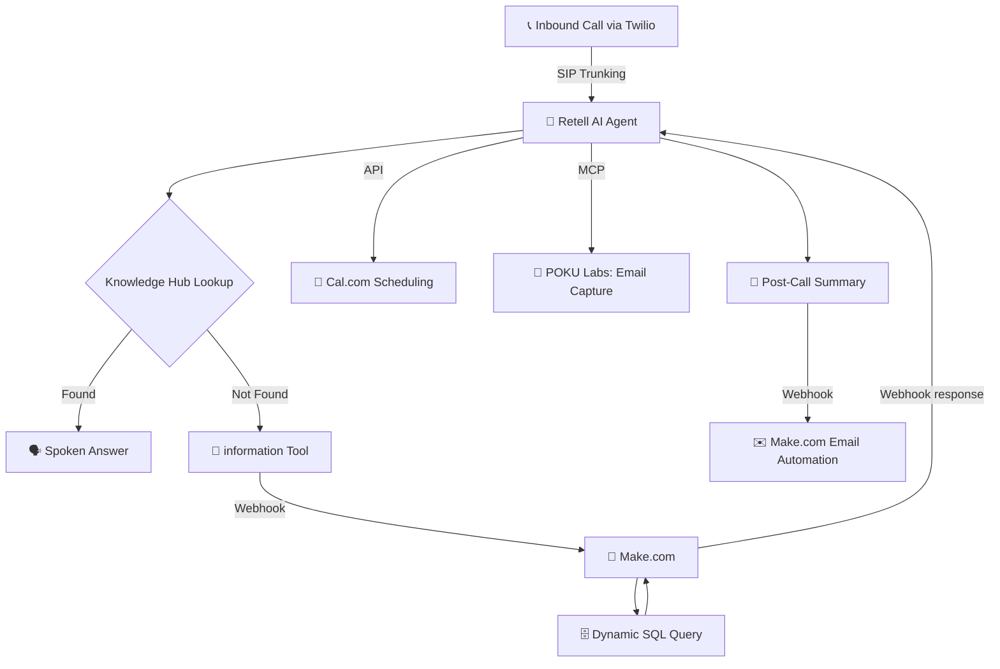
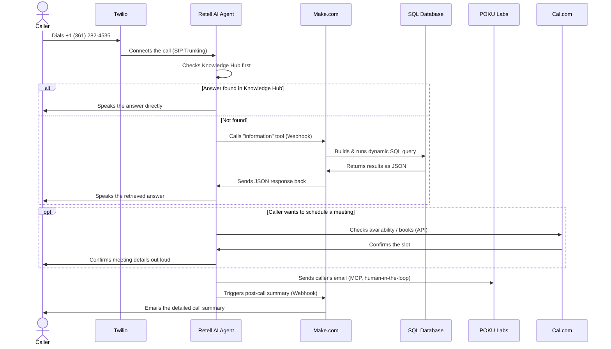

# 🎙️ Aneesh AI Voice Assistant

[](#-tech-stack--integrations)
[](#-tech-stack--integrations)
[](#-tech-stack--integrations)
[](#-tech-stack--integrations)
[](#️-note)

An AI-powered **voice assistant** for inbound calls that talks about my professional background, projects, and experience, and can schedule meetings live, during the call.

Built with **Retell AI** + **Twilio** for the call layer, backed by a **Knowledge Hub → SQL fallback** reasoning chain, **Make.com** automation, **POKU Labs** for human-in-the-loop email capture, and **Cal.com** for real scheduling.

<div align="center">

### 📞 Call the Assistant: **+1 (361) 282-4535**
*(Test number · limited usage, see [Note](#️-note))*

</div>

---

## 📑 Table of Contents

- [How It Works](#-how-it-works-at-a-glance)
- [Integration Connection Map](#-integration-connection-map)
- [What Happens When Someone Calls](#-what-happens-when-someone-calls-step-by-step)
- [Retell AI Agent Prompt Design](#-retell-ai-agent-prompt-design)
- [Knowledge Retrieval Logic](#-knowledge-retrieval-logic)
- [Custom Tool: `information`](#-custom-tool-information)
- [Make.com Automation Workflow](#-makecom-automation-workflow)
- [SQL Database Integration](#️-sql-database-integration)
- [POKU Labs – Human-in-the-Loop](#-poku-labs--human-in-the-loop-integration)
- [Post-Call Summary Function](#-post-call-detailed-summary-function)
- [System Design Principles](#-system-design-principles)
- [Key Highlights](#-key-highlights)
- [Tech Stack & Integrations](#-tech-stack--integrations)
- [Why This Project?](#-why-this-project)
- [Note](#️-note)
- [Try It Now](#️-try-it-now)

---

## 🧭 How It Works, At a Glance



<details>
<summary><strong>Read the flow as a numbered sequence</strong></summary>

1. Caller dials the Twilio number → routed to the Retell AI agent.
2. The agent first checks the **Knowledge Hub** (resume, projects, education, experience).
3. If the answer isn't there, it calls the **`information`** custom tool.
4. That tool hits a **Make.com webhook**, which builds and runs a **dynamic SQL query**.
5. Results flow back through Make.com → Retell AI → spoken response.
6. At any point, the agent can route into **Cal.com** to check availability, book, reschedule, or cancel a meeting.
7. **POKU Labs** captures the caller's email mid-conversation without breaking the flow.
8. After the call, a **post-call summary function** fires, sending a structured recap via **Make.com email automation**.

</details>

---

## 🔌 Integration Connection Map

Every integration is configured **inside Retell AI** itself (as a custom tool), and the system prompt tells the agent **when** to call each one. This map shows how each service physically connects to the agent, and over what protocol:

<div align="center">

<svg width="1060" height="700" viewBox="0 0 1060 700" style="max-width:100%;height:auto;" xmlns="http://www.w3.org/2000/svg">
  <defs>
    <marker id="arrow" viewBox="0 0 10 10" refX="9" refY="5" markerWidth="7" markerHeight="7" orient="auto-start-reverse">
      <path d="M0,0 L10,5 L0,10 z" fill="#8395a7" />
    </marker>
  </defs>

  <text x="530" y="24" text-anchor="middle" font-family="Segoe UI, Helvetica, Arial, sans-serif" font-size="20" font-weight="700" fill="#6C5CE7">Integration Connection Map</text>

  <!-- Connectors (drawn first, under the nodes) -->
  <path d="M160,335 L210,335" stroke="#8395a7" stroke-width="2" marker-end="url(#arrow)" fill="none" />
  <text x="185" y="322" text-anchor="middle" font-family="Segoe UI, Helvetica, Arial, sans-serif" font-size="12" fill="#8395a7">Inbound Call</text>

  <path d="M360,335 L420,335" stroke="#F22F46" stroke-width="2.5" marker-start="url(#arrow)" marker-end="url(#arrow)" fill="none" />
  <text x="390" y="318" text-anchor="middle" font-family="Segoe UI, Helvetica, Arial, sans-serif" font-size="12" font-weight="700" fill="#F22F46">SIP Trunking</text>

  <path d="M660,300 L760,60" stroke="#3A5CFF" stroke-width="2.5" marker-start="url(#arrow)" marker-end="url(#arrow)" fill="none" />
  <text x="700" y="175" text-anchor="start" font-family="Segoe UI, Helvetica, Arial, sans-serif" font-size="12" font-weight="700" fill="#3A5CFF">Webhook</text>

  <path d="M890,100 L890,130" stroke="#636e72" stroke-width="2" marker-start="url(#arrow)" marker-end="url(#arrow)" fill="none" />
  <text x="900" y="120" text-anchor="start" font-family="Segoe UI, Helvetica, Arial, sans-serif" font-size="11" fill="#636e72">SQL Query</text>

  <path d="M660,335 L760,340" stroke="#00b894" stroke-width="2.5" marker-start="url(#arrow)" marker-end="url(#arrow)" fill="none" />
  <text x="710" y="318" text-anchor="middle" font-family="Segoe UI, Helvetica, Arial, sans-serif" font-size="12" font-weight="700" fill="#00b894">MCP</text>

  <path d="M660,370 L760,600" stroke="#292929" stroke-width="2.5" marker-start="url(#arrow)" marker-end="url(#arrow)" fill="none" />
  <text x="705" y="485" text-anchor="start" font-family="Segoe UI, Helvetica, Arial, sans-serif" font-size="12" font-weight="700" fill="#292929">API (REST)</text>

  <path d="M540,405 L540,460" stroke="#6C5CE7" stroke-width="2" stroke-dasharray="4 4" fill="none" />

  <!-- Nodes -->
  <g>
    <rect x="20" y="300" width="140" height="70" rx="12" fill="#2d3436" />
    <text x="90" y="340" text-anchor="middle" font-family="Segoe UI, Helvetica, Arial, sans-serif" font-size="15" font-weight="700" fill="#ffffff">☎️ Caller</text>
    <text x="90" y="358" text-anchor="middle" font-family="Segoe UI, Helvetica, Arial, sans-serif" font-size="11" fill="#dfe6e9">PSTN</text>
  </g>

  <g>
    <rect x="210" y="300" width="150" height="70" rx="12" fill="#F22F46" />
    <text x="285" y="341" text-anchor="middle" font-family="Segoe UI, Helvetica, Arial, sans-serif" font-size="15" font-weight="700" fill="#ffffff">📞 Twilio</text>
  </g>

  <g>
    <rect x="420" y="265" width="240" height="140" rx="16" fill="#6C5CE7" />
    <text x="540" y="320" text-anchor="middle" font-family="Segoe UI, Helvetica, Arial, sans-serif" font-size="18" font-weight="700" fill="#ffffff">🤖 Retell AI Agent</text>
    <text x="540" y="345" text-anchor="middle" font-family="Segoe UI, Helvetica, Arial, sans-serif" font-size="11" fill="#e8e5ff">All tools are defined here.</text>
    <text x="540" y="361" text-anchor="middle" font-family="Segoe UI, Helvetica, Arial, sans-serif" font-size="11" fill="#e8e5ff">The system prompt decides</text>
    <text x="540" y="377" text-anchor="middle" font-family="Segoe UI, Helvetica, Arial, sans-serif" font-size="11" fill="#e8e5ff">WHEN each tool gets called.</text>
  </g>

  <g>
    <rect x="760" y="20" width="260" height="80" rx="12" fill="#3A5CFF" />
    <text x="890" y="55" text-anchor="middle" font-family="Segoe UI, Helvetica, Arial, sans-serif" font-size="15" font-weight="700" fill="#ffffff">🔗 Make.com</text>
    <text x="890" y="75" text-anchor="middle" font-family="Segoe UI, Helvetica, Arial, sans-serif" font-size="11" fill="#dfe6ff">Automation + email</text>
  </g>

  <g>
    <rect x="800" y="130" width="180" height="60" rx="10" fill="#636e72" />
    <text x="890" y="165" text-anchor="middle" font-family="Segoe UI, Helvetica, Arial, sans-serif" font-size="13" font-weight="700" fill="#ffffff">🗄️ SQL Database</text>
  </g>

  <g>
    <rect x="760" y="300" width="260" height="80" rx="12" fill="#00b894" />
    <text x="890" y="335" text-anchor="middle" font-family="Segoe UI, Helvetica, Arial, sans-serif" font-size="15" font-weight="700" fill="#ffffff">📩 POKU Labs</text>
    <text x="890" y="355" text-anchor="middle" font-family="Segoe UI, Helvetica, Arial, sans-serif" font-size="11" fill="#e3fff3">Human-in-the-loop email capture</text>
  </g>

  <g>
    <rect x="760" y="560" width="260" height="80" rx="12" fill="#292929" />
    <text x="890" y="595" text-anchor="middle" font-family="Segoe UI, Helvetica, Arial, sans-serif" font-size="15" font-weight="700" fill="#ffffff">📅 Cal.com</text>
    <text x="890" y="615" text-anchor="middle" font-family="Segoe UI, Helvetica, Arial, sans-serif" font-size="11" fill="#dddddd">Availability, booking, reschedule</text>
  </g>

  <g>
    <rect x="420" y="460" width="240" height="110" rx="12" fill="none" stroke="#6C5CE7" stroke-width="2" stroke-dasharray="5 4" />
    <text x="540" y="488" text-anchor="middle" font-family="Segoe UI, Helvetica, Arial, sans-serif" font-size="12" font-weight="700" fill="#6C5CE7">🧠 "When to call" logic</text>
    <text x="540" y="508" text-anchor="middle" font-family="Segoe UI, Helvetica, Arial, sans-serif" font-size="11" fill="#6C5CE7">lives in the Retell AI</text>
    <text x="540" y="524" text-anchor="middle" font-family="Segoe UI, Helvetica, Arial, sans-serif" font-size="11" fill="#6C5CE7">system prompt, not in code</text>
    <text x="540" y="548" text-anchor="middle" font-family="Segoe UI, Helvetica, Arial, sans-serif" font-size="10" fill="#6C5CE7">(configuration, not a live call-time hop)</text>
  </g>

  <g>
    <rect x="20" y="610" width="340" height="70" rx="10" fill="none" stroke="#8395a7" stroke-width="1.5" />
    <text x="35" y="633" font-family="Segoe UI, Helvetica, Arial, sans-serif" font-size="11" font-weight="700" fill="#8395a7">Legend</text>
    <text x="35" y="652" font-family="Segoe UI, Helvetica, Arial, sans-serif" font-size="11" fill="#8395a7">Solid, colored line: live connection during a call</text>
    <text x="35" y="670" font-family="Segoe UI, Helvetica, Arial, sans-serif" font-size="11" fill="#8395a7">┄ Dashed line: prompt-level configuration reference</text>
  </g>
</svg>

</div>

| Service | Connects To Retell AI Via | Direction |
|---|---|---|
| **Twilio** | SIP Trunking | Carries the live call audio both ways |
| **Make.com** | Webhook (JSON) | Agent calls out, Make.com calls back with results |
| **POKU Labs** | MCP | Human-in-the-loop email capture, mid-call |
| **Cal.com** | API (REST) | Availability checks, booking, rescheduling, cancellation |

---

## 📞 What Happens When Someone Calls, Step-by-Step

This is the same flow as the map above, but as a timeline: exactly what fires, in order, for a real call.



Every arrow above corresponds to a real, configured tool call inside Retell AI. The agent itself never hardcodes "call Cal.com now"; that decision comes from the **system prompt's instructions on when each tool applies** (see [Retell AI Agent Prompt Design](#-retell-ai-agent-prompt-design) below).

---

## 🎯 Retell AI Agent Prompt Design

The Retell AI agent is configured using a structured system prompt that defines **objective, tone, behavior, and tool usage**.

<table>
<tr><th>Prompt Layer</th><th>What It Controls</th></tr>
<tr>
<td><strong>Objective</strong></td>
<td>

- Act as a professional AI voice assistant
- Answer questions about my **professional summary, projects, education, experience**
- Allow callers to **schedule meetings**
- **Collect user email** politely during the call

</td>
</tr>
<tr>
<td><strong>Tone</strong></td>
<td>

- Friendly, calm, and professional
- Human-like conversational flow
- Clear, concise, and confident
- Polite handling of unknown queries

</td>
</tr>
<tr>
<td><strong>Speech</strong></td>
<td>

- Natural pacing and pauses
- No robotic responses
- Clear pronunciation
- Context-aware follow-up questions

</td>
</tr>
</table>

<p align="center">

</p>

---

## 🧠 Knowledge Retrieval Logic

During a conversation, the agent follows this decision order:

1. **Search Knowledge Hub**: resume data, professional experience, projects, education.
2. **If information is NOT found**: call the custom tool `information` and fetch data from external systems (SQL database).

This keeps answers **fast and cheap** when the Knowledge Hub already has the answer, and falls back to **live, deterministic data** only when needed.

---

## 🔧 Custom Tool: `information`

The `information` tool is a backend function defined in Retell AI.

| Field | Value |
|---|---|
| **Tool Name** | `information` |
| **Purpose** | Fetch structured or external data |
| **Trigger Condition** | Knowledge Hub miss |
| **Integration** | Webhook via Make.com |
| **Input / Output** | JSON |

<details>
<summary><strong>📄 View example tool input schema (JSON)</strong></summary>

```json
{
  "type": "object",
  "properties": {
    "email": {
      "type": "string",
      "description": "The customer's email address, any domain allowed."
    },
    "products": {
      "type": "array",
      "description": "List of products the customer wants a quote for.",
      "items": {
        "type": "object",
        "properties": {
          "link": { "type": "string" },
          "warranty": { "type": "string" },
          "delivery_days": { "type": "string" },
          "main_features": { "type": "string" },
          "product_name": { "type": "string" },
          "price": { "type": "string" }
        },
        "required": ["product_name", "price", "main_features"]
      }
    }
  },
  "required": ["email", "products"]
}
```

</details>

---

## 🔄 Make.com Automation Workflow

When the `information` tool is called:

<details open>
<summary><strong>Step-by-step pipeline</strong></summary>

1. Retell AI sends a **JSON payload** to a Make.com webhook
2. Make.com parses the incoming request
3. A **dynamic SQL query** is constructed
4. The query is executed against the SQL database
5. Query results are formatted into **JSON**
6. The JSON response is sent back to Retell AI
7. Retell AI converts the response into **natural spoken output**

</details>

<p align="center">

</p>

---

## 🗄️ SQL Database Integration

- Uses **dynamic SQL queries**
- Query parameters are filled using **user input**
- Keeps structured data **separate from the LLM**
- Enables **accurate, controlled, and deterministic responses**

<p align="center">

</p>

---

## 📩 POKU Labs – Human-in-the-Loop Integration

Before the call ends:

- **POKU Labs** is triggered mid-conversation
- Collects the caller's **email address**
- Works as a **human-in-the-loop system**
- Integrated with Retell AI using **MCP**
- Data is passed instantly **without breaking conversation flow**

---

## 📝 Post-Call Detailed Summary Function

After the call ends, a custom function generates a **detailed call summary**.

<details>
<summary><strong>What's in the summary</strong></summary>

- Caller phone number
- Caller email address
- Conversation summary
- User questions
- Meeting date & time (if scheduled)

</details>

**Output format:** Structured JSON → sent via **Make.com email automation** → can be stored in a **database** if required.

---

## 🔐 System Design Principles

- Tool-based reasoning to **avoid hallucinations**
- **Knowledge-first, database-second** approach
- Clear separation of **AI, automation, and data layers**
- Scalable design for **complex voice agents**
- **Cost-aware** testing setup

---

## ✨ Key Highlights

| | |
|---|---|
| ✅ | AI-powered inbound voice agent |
| ✅ | Answers questions about my **resume & projects** |
| ✅ | Collects **email address** during the call |
| ✅ | Schedules **meetings live on call** |
| ✅ | Sends **detailed call summary via email** |
| ✅ | Integrated **Cal.com** for live calendar availability checks, meeting booking, rescheduling & cancellation |

---

## 🧠 Tech Stack & Integrations

| Component | Role |
|---|---|
| **Retell AI** | Voice agent & conversation logic |
| **Twilio** | Inbound calling number |
| **Knowledge Hub** | Resume & professional data |
| **POKU Labs** | Mid-call data collection (email, meeting info) |
| **Make.com** | Automation, SQL DB & email workflows |
| **Cal.com** | Calendar availability, meeting booking, rescheduling & cancellation |

---

## 🚀 Why This Project?

This voice agent acts as a:

- 🤖 Personal AI assistant
- 📄 Voice-based professional portfolio
- 📅 Meeting scheduler
- 📊 Lead & interaction tracker

---

## ⚠️ Note

This is a **demo/testing voice agent**.
Usage is limited due to operational costs, but the architecture supports **complex, scalable voice agents**.

---

## ☎️ Try It Now

Call the number and ask about:

- My professional experience
- My projects
- My education
- Scheduling a meeting

<div align="center">

### 📞 **+1 (361) 282-4535**

</div>
